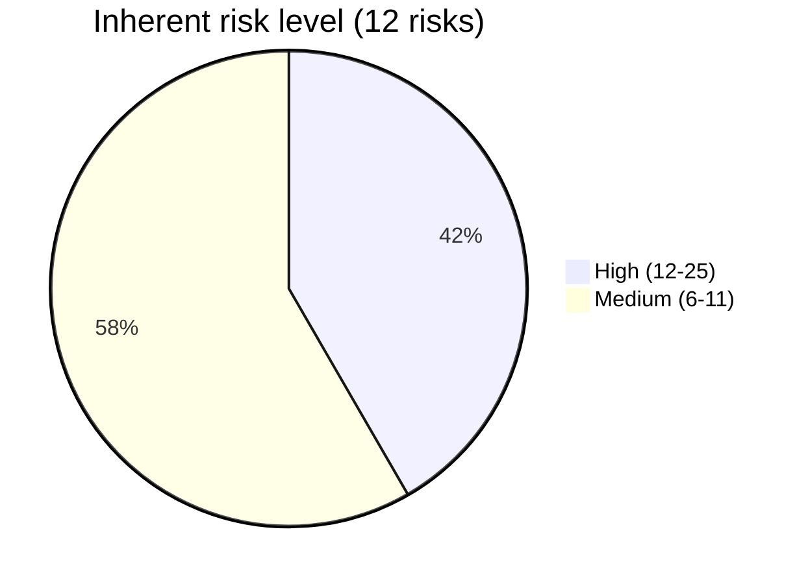
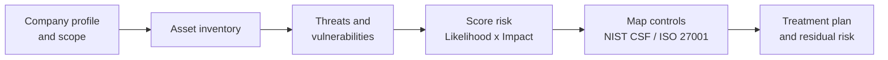

# GRC Risk Assessment: Small Business Case Study

A complete **information security risk assessment** for a fictional small business, **Harbor Café Ltd.**, with a risk register, a control mapping to **NIST CSF 2.0** and **ISO/IEC 27001:2022 Annex A**, and a prioritised treatment plan.

**Read it online:** https://ottonielmorais2008-rgb.github.io/grc-risk-assessment/

> Harbor Café Ltd. is fictional. This is a portfolio exercise that shows the GRC (Governance, Risk and Compliance) process end to end.

## Summary

| Item | Result |
|------|--------|
| Assets in scope | 10 |
| Risks identified | 12 |
| High risks | 5 |
| Medium risks | 7 |
| Top 3 risks | Phishing, no MFA / shared passwords, ransomware without tested backups |

## How it was done

## Contents

1. [Company profile and scope](docs/01-company-profile.md)
2. [Methodology](docs/02-methodology.md)
3. [Risk register](docs/03-risk-register.md) (also as [CSV](risk-register.csv))
4. [Control mapping](docs/04-control-mapping.md)
5. [Treatment plan](docs/05-treatment-plan.md)

## Skills shown

- Asset identification and risk scoring (likelihood x impact)
- Mapping risks to recognised frameworks (NIST CSF 2.0, ISO/IEC 27001:2022)
- Practical, low-cost recommendations for a small business
- Clear technical writing for non-technical owners

## License

[MIT](LICENSE)
